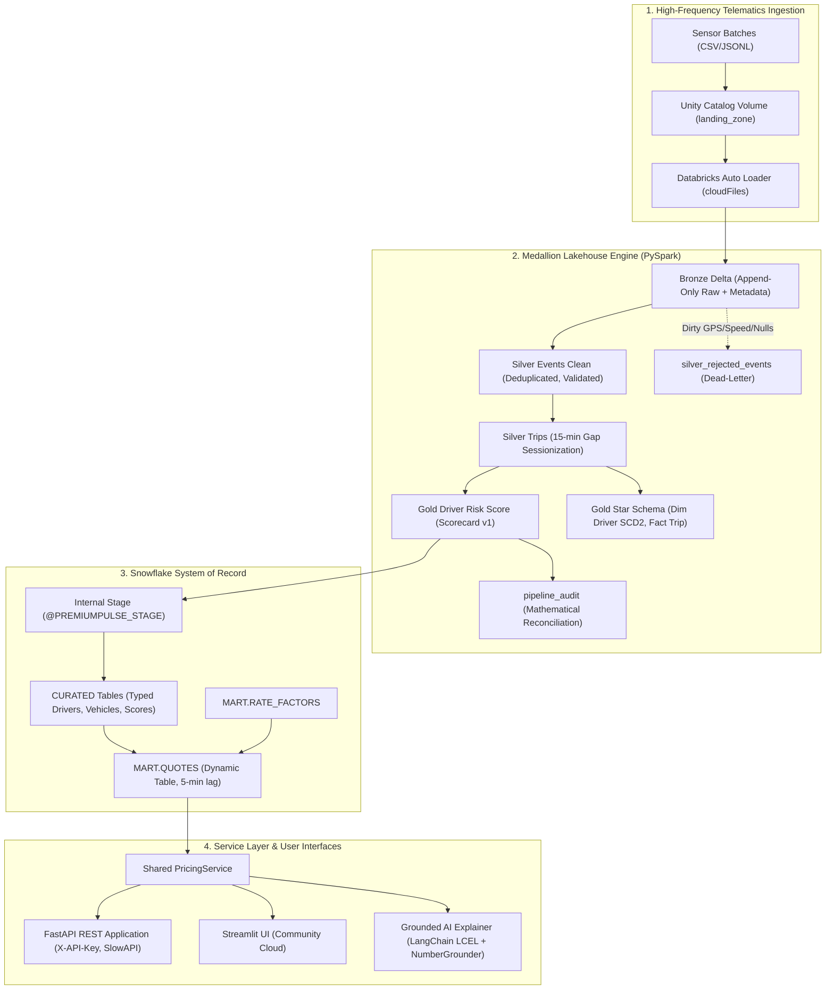

# PremiumPulse Architecture Blueprint

This document specifies the technical architecture, data flow, failure modes, and security design for **PremiumPulse**.

---

## 1. High-Level Data Flow

---

## 2. Medallion Layer Specifications

### Bronze Layer (`bronze_telematics_events`, `bronze_drivers`, `bronze_vehicles`)
* **Engine**: Databricks Auto Loader (`cloudFiles`).
* **Characteristics**: Append-only, zero business logic mutations.
* **Schema Evolution**: Configured with `schemaEvolutionMode=addNewColumns` to absorb drifting sensor metrics (e.g. `ambient_temp_c`) without crashing pipelines.
* **Metadata Columns**: `_source_file` (`STRING`), `_ingested_at` (`TIMESTAMP`).

### Silver Layer (`silver_trips`, `silver_rejected_events`, `silver_dq_results`)
* **Cleaning Rules**:
  * Deduplication: `row_number() OVER (PARTITION BY event_id ORDER BY _ingested_at DESC) = 1`.
  * GPS Bounds: Latitude $[-90.0, 90.0]$, Longitude $[-180.0, 180.0]$.
  * Speed Bounds: $[0.0, 250.0]$ km/h.
  * Non-null event timestamps.
* **Trip Sessionization**:
  * Drivers and vehicles are ordered by `event_ts`.
  * An inactivity threshold $> 15$ minutes triggers a new `trip_id` via `lag()` + cumulative conditional sum.
* **Trip Metrics**:
  * Distance: Pure Spark SQL Haversine expression.
  * Hard Braking: Deceleration $\le -3.0\text{ m/s}^2$.
  * Hard Acceleration: Acceleration $\ge +3.0\text{ m/s}^2$.
  * Speeding: Speed $> \text{Speed Limit} + 10\text{ km/h}$.
  * Night Driving: Driving between 00:00 and 04:00 AM.
  * Phone Usage: Sensor `phone_in_use == 1`.

### Gold Layer (`gold_driver_risk_score`, `gold_dim_driver`, `gold_dim_vehicle`, `gold_fact_trip`)
* **Scorecard Evaluation**: Evaluates rolling 30-day driving metrics against Scorecard v1 point deduction formula.
* **Kimball Star Schema**: Dimensions with SHA-256 surrogate keys; `gold_dim_driver` supports SCD Type 2 with effective date ranges.
* **Optimizations**: `OPTIMIZE ... ZORDER BY (driver_id)` for high-cardinality lookups.

---

## 3. Snowflake Serving Architecture

* **Warehouse**: `PP_WH` (X-Small, 60-second auto-suspend).
* **Dynamic Table**: `MART.QUOTES` automatically synchronizes downstream quotes when CURATED tables update, joining with `RATE_FACTORS` to apply multiplicative pricing.
* **Governance**: Dynamic Data Masking automatically redacts full name and email for `PP_VIEWER` while granting cleartext to `PP_UNDERWRITER`.
* **Disaster Recovery**: Snowflake Time Travel and Zero-Copy Cloning (`PREMIUMPULSE_DB_WHATIF`) allow instant simulation sandboxing without data duplication.
